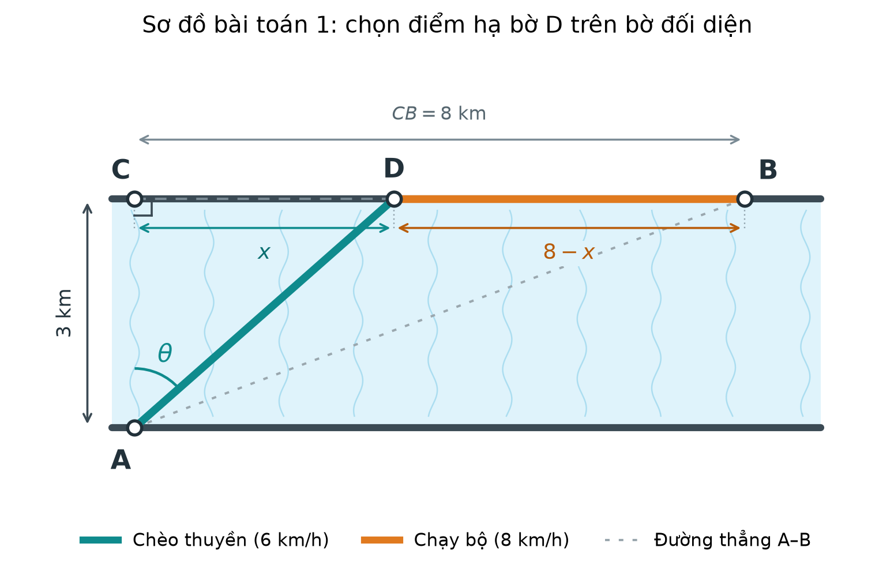
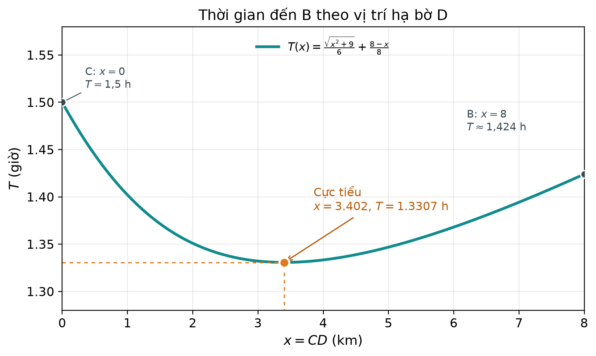
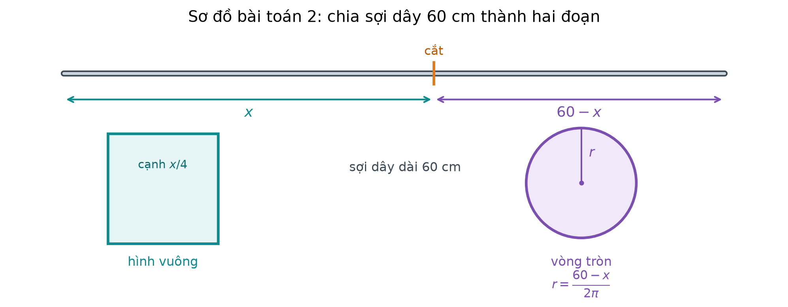
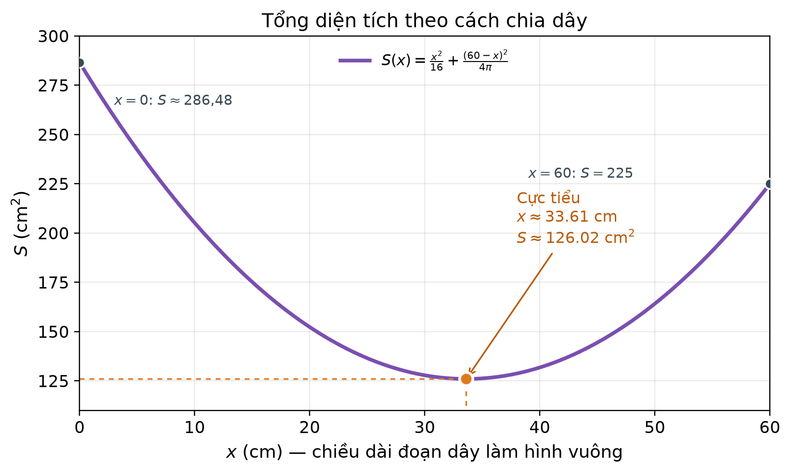

# Lời giải

## Bài 1. Luyện tập 2

**Phân tích bài toán**

- Chiều rộng con sông: \(AC=3\) km.
- Khoảng cách từ \(C\) đến \(B\): \(CB=8\) km.
- Vận tốc chèo thuyền: \(v_1=6\) km/h.
- Vận tốc chạy bộ: \(v_2=8\) km/h.
- Gọi \(D\) là điểm hạ bờ, nằm giữa \(C\) và \(B\). Đặt \(CD=x\) (km), với \(0\le x\le 8\).

*Hình 1. Sơ đồ chọn điểm hạ bờ \(D\) trên bờ đối diện.*

**Giải chi tiết**

1. **Tính quãng đường và thời gian**

Tam giác \(ACD\) vuông tại \(C\), nên

$$
AD=\sqrt{AC^2+CD^2}=\sqrt{3^2+x^2}=\sqrt{x^2+9}\ \text{(km)}.
$$

Thời gian chèo thuyền:

$$
t_1=\frac{AD}{v_1}=\frac{\sqrt{x^2+9}}{6}\ \text{(giờ)}.
$$

Quãng đường chạy bộ:

$$
DB=CB-CD=8-x\ \text{(km)}.
$$

Thời gian chạy bộ:

$$
t_2=\frac{DB}{v_2}=\frac{8-x}{8}\ \text{(giờ)}.
$$

2. **Thiết lập hàm tổng thời gian**

Tổng thời gian anh An đi từ \(A\) đến \(B\) là

$$
T(x)=t_1+t_2=\frac{\sqrt{x^2+9}}{6}+\frac{8-x}{8},
\qquad 0\le x\le 8.
$$

Ta cần tìm \(x\) để \(T(x)\) nhỏ nhất.

3. **Tìm giá trị nhỏ nhất của \(T(x)\)**

Tính đạo hàm:

$$
T'(x)=\frac{1}{6}\cdot\frac{x}{\sqrt{x^2+9}}-\frac{1}{8}
=\frac{x}{6\sqrt{x^2+9}}-\frac{1}{8}.
$$

Cho \(T'(x)=0\):

$$
\frac{x}{6\sqrt{x^2+9}}=\frac{1}{8}
\;\Longleftrightarrow\;
8x=6\sqrt{x^2+9}
\;\Longleftrightarrow\;
4x=3\sqrt{x^2+9}.
$$

Vì \(x\ge 0\), bình phương hai vế:

$$
16x^2=9(x^2+9)
\;\Longleftrightarrow\;
16x^2=9x^2+81
\;\Longleftrightarrow\;
7x^2=81.
$$

Suy ra

$$
x=\frac{9}{\sqrt7}=\frac{9\sqrt7}{7}\approx 3{,}40\ \text{(km)}.
$$

Giá trị này nằm trong đoạn \([0;8]\).

Để xét dấu \(T'(x)\), viết

$$
T'(x)=\frac{4x-3\sqrt{x^2+9}}{24\sqrt{x^2+9}}.
$$

Tử số là hàm liên tục và chỉ triệt tiêu tại \(x=\dfrac{9}{\sqrt7}\), vì phương trình \(4x=3\sqrt{x^2+9}\) có nghiệm duy nhất. Hơn nữa \(T'(0)=-\dfrac18<0\) và \(T'(8)>0\), nên \(T'(x)<0\) trên \(\left[0;\dfrac{9}{\sqrt7}\right)\) và \(T'(x)>0\) trên \(\left(\dfrac{9}{\sqrt7};8\right]\).

Ta có bảng biến thiên:

$$
\begin{array}{c|ccccc}
x & 0 & & \dfrac{9}{\sqrt7} & & 8 \\
\hline
T'(x) & & - & 0 & + & \\
\hline
T(x) & \dfrac32 & \searrow & 1+\dfrac{\sqrt7}{8} & \nearrow & \dfrac{\sqrt{73}}{6}
\end{array}
$$

Từ bảng biến thiên, \(T(x)\) đạt giá trị nhỏ nhất tại \(x=\dfrac{9}{\sqrt7}\).

*Hình 2. Đồ thị của \(T(x)\) trên đoạn \([0;8]\).*

4. **Kết luận**

Anh An phải chèo thuyền sang bờ tại điểm \(D\) cách \(C\) một khoảng

$$
\boxed{CD=\frac{9}{\sqrt7}\ \text{km}\approx 3{,}40\ \text{km}}.
$$

---

## Bài 2

**Phân tích bài toán**

- Tổng chiều dài sợi dây: \(60\) cm.
- Gọi \(x\) (cm) là chiều dài đoạn dây uốn thành hình vuông, \(0<x<60\).
- Chiều dài đoạn dây uốn thành hình tròn là \(60-x\) (cm).
- Mục tiêu: tìm \(x\) để tổng diện tích hình vuông và hình tròn nhỏ nhất.

*Hình 3. Chia sợi dây dài 60 cm thành hai đoạn.*

**Giải chi tiết**

1. **Tính diện tích từng hình**

- **Hình vuông:** đoạn dây dài \(x\) là chu vi hình vuông.

Cạnh hình vuông:

$$
a=\frac{x}{4}\ \text{(cm)}.
$$

Diện tích hình vuông:

$$
S_1=a^2=\left(\frac{x}{4}\right)^2=\frac{x^2}{16}\ \text{(cm}^2).
$$

- **Hình tròn:** đoạn dây dài \(60-x\) là chu vi hình tròn.

Bán kính hình tròn:

$$
2\pi r=60-x
\;\Longrightarrow\;
r=\frac{60-x}{2\pi}\ \text{(cm)}.
$$

Diện tích hình tròn:

$$
S_2=\pi r^2
=\pi\left(\frac{60-x}{2\pi}\right)^2
=\frac{(60-x)^2}{4\pi}\ \text{(cm}^2).
$$

2. **Thiết lập hàm tổng diện tích**

Tổng diện tích:

$$
S(x)=S_1+S_2
=\frac{x^2}{16}+\frac{(60-x)^2}{4\pi},
\qquad 0<x<60.
$$

3. **Tìm giá trị nhỏ nhất của \(S(x)\)**

Tính đạo hàm:

$$
S'(x)=\frac{2x}{16}-\frac{2(60-x)}{4\pi}
=\frac{x}{8}-\frac{60-x}{2\pi}.
$$

Cho \(S'(x)=0\):

$$
\frac{x}{8}=\frac{60-x}{2\pi}
\;\Longleftrightarrow\;
2\pi x=8(60-x)
\;\Longleftrightarrow\;
\pi x=4(60-x).
$$

Suy ra

$$
\pi x=240-4x
\;\Longleftrightarrow\;
x(\pi+4)=240
\;\Longleftrightarrow\;
x=\frac{240}{\pi+4}.
$$

Viết lại

$$
S'(x)=\frac{(\pi+4)x-240}{8\pi}.
$$

Đây là hàm bậc nhất có hệ số góc dương, triệt tiêu tại \(x=\dfrac{240}{\pi+4}\). Do đó \(S'(x)<0\) trên \(\left(0;\dfrac{240}{\pi+4}\right)\) và \(S'(x)>0\) trên \(\left(\dfrac{240}{\pi+4};60\right)\).

Ta có bảng biến thiên:

$$
\begin{array}{c|ccccc}
x & 0 & & \dfrac{240}{\pi+4} & & 60 \\
\hline
S'(x) & & - & 0 & + & \\
\hline
S(x) & \dfrac{900}{\pi} & \searrow & \dfrac{900}{\pi+4} & \nearrow & 225
\end{array}
$$

Từ bảng biến thiên, \(S(x)\) đạt giá trị nhỏ nhất tại \(x=\dfrac{240}{\pi+4}\).

*Hình 4. Đồ thị của \(S(x)\) trên khoảng \((0;60)\).*

4. **Tính kết quả**

Lấy \(\pi\approx 3{,}14159\):

$$
x=\frac{240}{3{,}14159+4}
=\frac{240}{7{,}14159}
\approx 33{,}606\ \text{(cm)}.
$$

Làm tròn đến hàng phần trăm:

$$
\boxed{x\approx 33{,}61\ \text{cm}}.
$$

5. **Kết luận**

Để tổng diện tích hình vuông và hình tròn nhỏ nhất, chiều dài đoạn dây uốn thành hình vuông phải bằng khoảng

$$
\boxed{33{,}61\ \text{cm}}.
$$
